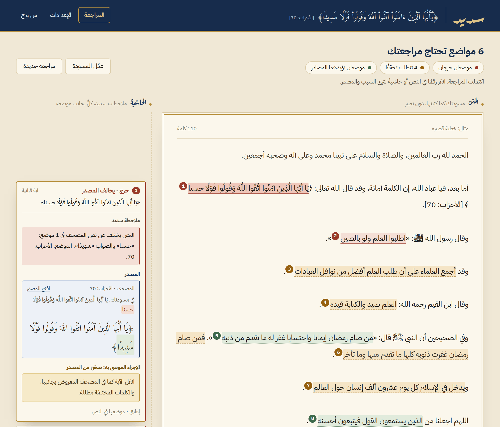
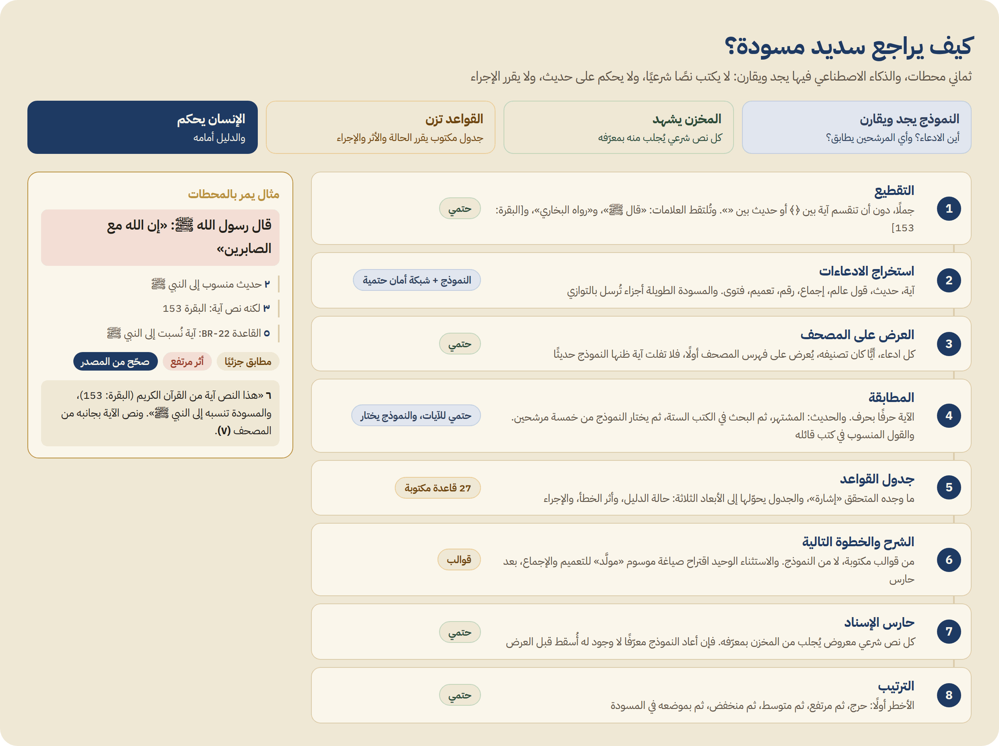
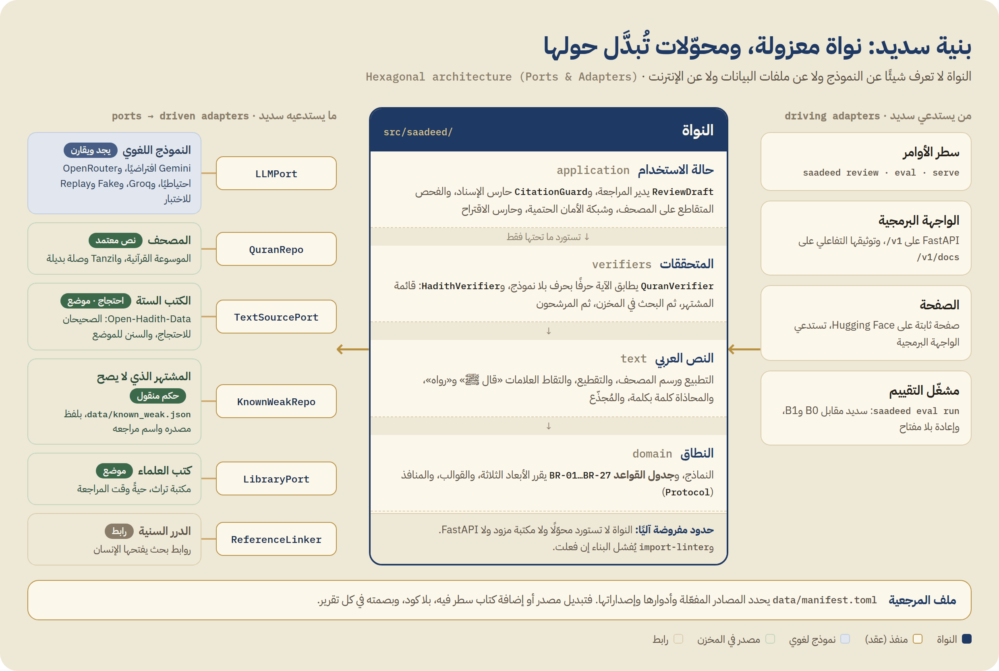

<p align="center">
  
</p>

<h1 align="center">Saadeed · سَدِيد</h1>

<p align="center"><b>A pre-publication reviewer for Arabic Islamic content</b><br>
It checks every claim in a sermon, lesson or article against vetted sources, and puts the evidence next to it.</p>

<p align="center">
  <a href="https://abdorum-saadeed.static.hf.space"><b>Live demo</b></a> ·
  <a href="README.md">العربية (main README)</a> ·
  <a href="#http-api">HTTP API</a> ·
  <a href="#architecture">Architecture</a>
</p>

<p align="center">
  
  
  
  
  
</p>

> **Status: frozen since 28 October 2026** at version 0.5.0. The demo page and its examples keep working, and live review works while the server and model provider are up. No new development until work resumes.

<p align="center">
  
  <br><sub>The draft stays untouched in the middle; Saadeed's notes sit in the margin. The open note shows a verse with one altered word, next to the Mushaf text fetched from the store.</sub>
</p>

## Why

Preachers and content creators increasingly draft with general-purpose AI. A draft can read well and still carry a verse with a changed word, a famous hadith that is not authentic, a saying attributed to the wrong scholar, or an unsupported "all scholars agree". Saadeed sits between the draft and the pulpit. It does not write for you. It shows you what you might miss, with the evidence, and leaves the judgement to you.

## What it does

Saadeed takes a full Arabic draft (up to 3,000 words) and extracts every claim: Quran verses, hadith, attributions, consensus claims, numbers, generalisations and personal-case fatwas. Each claim is matched against the configured sources and gets three things:

- **Evidence:** the source text with its exact location and link, always fetched from the store, never written by the model.
- **A status in three dimensions:** evidence status, severity and action. A written rule table decides them, not the model.
- **A next step:** nothing, verify, correct from source, rephrase, or refer to a scholar. Most severe first.

It never generates scripture, never issues fatwas, and never turns "not found" into "fabricated", or "found" into "authentic".

## Does it work?

Measured against **the same model on its own** with a good prompt (`gemini-3.5-flash-lite`), which is what writers do today:

| | Saadeed | Model alone |
|---|---|---|
| Detection (flawed claims flagged) | **96.7%** | 83.3% |
| False alarms on sound claims | **3.2%** | 16.1% |
| Missed critical cases | **0 of 24** | 2 |
| Fabricated citations | **0** | 5 |

- Significant (exact McNemar, p = 0.0075) on 91 cases, with a protocol registered before measuring.
- With a different model (`gpt-oss-120b`) Saadeed got the same numbers: the guarantees come from the architecture, not the model.
- On ten real published sermons (13,303 words): zero false critical alarms. The only critical alert was a real typo in a verse.
- Not yet shown: the held-out test set is frozen by hash but not run; it waits for its drafted cases to be approved.

Reproduce without any API key: `uv run saadeed eval run --split dev --systems saadeed,B0 --replay`.

## How it works



1. **Segmentation** into sentences, keeping verses in ﴿﴾ and hadith in «» whole, and catching markers such as «قال ﷺ» and «رواه البخاري». Deterministic.
2. **Claim extraction** by the model, backed by a deterministic safety net.
3. **Cross-check against the Mushaf:** every claim, whatever its predicted type, is checked against the Quran index first. Deterministic.
4. **Matching:** verses letter by letter with no model. Hadith go through the known-weak list, then a search of the six books, then the model picks from five store candidates. Sayings are looked up in their authors' books.
5. **Rule table:** 27 written rules turn each signal into the three dimensions.
6. **Explanation** from written templates. The only generated text is a clearly labelled rephrasing suggestion, behind a guard.
7. **Citation guard:** any reference the model returns that does not exist in the store is dropped.
8. **Ordering:** most severe first.

## For developers

### Architecture



- **The core has four layers:** `domain` ← `text` ← `verifiers` ← `application`. Each layer imports only the ones below it, and the core never imports an adapter, a provider SDK or FastAPI. Both contracts live in `pyproject.toml` and are enforced by `lint-imports`.
- **Ports** are `Protocol`s in `src/saadeed/domain/ports.py`: `LLMPort`, `QuranRepo`, `TextSourcePort`, `KnownWeakRepo`, `LibraryPort`, `ReferenceLinker`.
- **Adapters** live in `src/saadeed/adapters/`. `api`, `cli` and `eval` drive the core; `llm` and `sources` are driven through the ports. `factory.py` wires them together.
- **The source manifest** `data/manifest.toml` declares which sources are active, their versions and their **roles** (reference text, authentic, ruling, locate, link). The role caps what Saadeed may conclude from a source, and every report carries the manifest's fingerprint.

### Quick start

Requires Python 3.12 and [uv](https://docs.astral.sh/uv/).

```bash
git clone https://github.com/abdorum/Saadeed && cd Saadeed
uv sync                       # environment and dependencies
uv run saadeed data build     # download sources and build the indexes (once, ~230 MB)
cp .env.example .env          # add one API key, or leave empty for the deterministic path only
uv run saadeed serve          # web page + API on http://127.0.0.1:8000
```

### Command line

```bash
uv run saadeed review samples/alukah_hifz_allisan.txt            # a real published sermon
uv run saadeed review samples/demo_khutbah.txt --provider none   # no model: deterministic path only
uv run saadeed review draft.txt --json -o report.json            # full JSON report to a file
cat draft.txt | uv run saadeed review -                          # from stdin
uv run saadeed coverage                                          # active sources and their roles
```

### HTTP API

`uv run saadeed serve` starts it. Interactive docs are at `/v1/docs`, and the schema is in [`docs/openapi.json`](docs/openapi.json) for generating clients.

| Request | Purpose |
|---|---|
| `POST /v1/reviews` | Review a draft and return the report |
| `GET /v1/health` | Version, model and manifest fingerprint |
| `GET /v1/coverage` | Active sources, their roles, and the policies |
| `GET /v1/results` | Latest evaluation report (Saadeed vs. the model alone) |
| `POST /v1/llm/check` | Test a model key without storing it |

```bash
curl -s http://127.0.0.1:8000/v1/reviews \
  -H "Content-Type: application/json" \
  -d '{"text": "قال رسول الله ﷺ: «إن الله مع الصابرين».", "mode": "quick"}'
```

| Field | Values | Meaning |
|---|---|---|
| `text` | up to 3,000 words | The draft |
| `mode` | `full` (default) or `quick` | `quick` runs the deterministic path only: instant, no model |
| `llm` | `{"provider", "model", "api_key"}` | Model and key for this request only; never stored or logged. `"provider": "none"` forces the deterministic path |
| `overreach` | `false` or `true` | Experimental overreach check |

The response carries `summary`, `findings`, `top_risks`, `draft_map`, `coverage` and `meta`. Each finding has the claim and its span, the `rule_id`, the three dimensions, a templated `explanation` and `next_step`, the `evidence` with source references, and Arabic labels in `labels_ar`. In the example above, the "hadith" is actually Al-Baqarah 2:153: rule `BR-22`, `PARTIALLY_SUPPORTED`, `HIGH`, `CORRECT_FROM_SOURCE`.

| Dimension | Values |
|---|---|
| `evidence_status` | `SUPPORTED` · `PARTIALLY_SUPPORTED` · `EXCEEDS_SOURCE` · `CONTRADICTED` · `FOUND_NO_RULING` · `NOT_FOUND` · `OUT_OF_SCOPE` · `NOT_CHECKED` |
| `severity` | `CRITICAL` · `HIGH` · `MEDIUM` · `LOW` · `NONE` |
| `action` | `NONE` · `VERIFY` · `CORRECT_FROM_SOURCE` · `RECONSIDER` · `REPHRASE` · `REFER` |
| `bucket` | `SUPPORTED_BY_SOURCES` · `NEEDS_VERIFICATION` · `REFER` · `NOT_CHECKED` |

- **Errors:** `422` for an empty or over-long draft, `429` when an address exceeds the per-minute limit for full reviews, `400` for an invalid provider or key in `llm`. The reason, in Arabic, is in `detail`.
- **Degraded reviews are never hidden:** if the model fails, the deterministic path still runs, `meta.degraded` is `true`, and `summary.not_checked` lists what was skipped.
- **Browser calls** are allowed from the origins in `SAADEED_CORS_ORIGIN_REGEX`.

### As a Python library

```python
from saadeed.adapters.factory import build_engine, build_llm

engine = build_engine()                         # builds the indexes once; reuse it
reviewer = engine.reviewer(build_llm("none"))   # build_llm() uses the model configured in .env
report = reviewer.review("قال رسول الله ﷺ: «إن الله مع الصابرين».")

for f in report.findings:
    print(f.rule_id, f.evidence_status, f.explanation)
```

`report` is a pydantic model with the same schema as the API response. Use `report.model_dump(mode="json")` to get JSON.

### Configuration

Everything is an environment variable in `.env`, which is never committed.

| Variable | Default | Purpose |
|---|---|---|
| `GEMINI_API_KEY` | none | Default model `gemini-3.5-flash-lite` |
| `OPENROUTER_API_KEY` | none | Fallback when Gemini fails |
| `GROQ_API_KEY` | none | Full alternative, with `SAADEED_LLM_PROVIDER=groq` |
| `SAADEED_LLM_PROVIDER` / `SAADEED_LLM_MODEL` | `gemini` / per provider | Switch provider or model without touching code |
| `SAADEED_LIBRARY` | `turath` | Live search in scholars' books; `off` disables it |
| `SAADEED_RATE_LIMIT` | `12` | Full reviews per address per minute |
| `SAADEED_CORS_ORIGIN_REGEX` | Hugging Face origins | Which browser origins may call the API |
| `SAADEED_WEB` / `SAADEED_WEB_URL` | `on` / the HF page | `off` serves the API only and redirects `/` to `SAADEED_WEB_URL` |
| `SAADEED_CACHE_DIR` | `.cache/llm` | Model-call cache for the CLI and evaluation |
| `SAADEED_DATA_DIR`, `SAADEED_MANIFEST`, `SAADEED_PROMPTS_DIR` | repo folders | Run with other data, manifest or prompts |

### Deployment

- **Server:** `deploy/saadeed.service` is a systemd unit that runs `saadeed serve` behind a reverse proxy, restarts it on failure, and caps its memory and CPU.
- **Static page only:** `bash deploy/deploy_hf_static.sh` publishes `web/` as a static Hugging Face Space that calls the server.
- **Docker:** one image with the page and the API; the data is built inside the image.
  ```bash
  docker build -t saadeed . && docker run -p 7860:7860 --env-file .env saadeed   # http://127.0.0.1:7860
  ```

### Extending

- **Another hadith book** from Open-Hadith-Data: one line in `data/manifest.toml` with its role (`AUTHENTIC` or `LOCATE`). No code.
- **A new kind of source:** an adapter in `src/saadeed/adapters/sources/` implementing the right port, a branch in `adapters/bootstrap.py`, and a line in the manifest.
- **A new model provider:** a class with `model_id` and `generate_json(system, user, max_tokens)` (the `LLMPort` contract), and a branch in `build_llm` in `adapters/factory.py`.
- **A new rule or claim type:** `domain/enums.py`, `domain/policy.py` and `domain/templates.py`. `tests/unit/test_extensibility.py` fails if a step is forgotten. Any change to a religious ruling in the table should be reviewed by a qualified scholar.

### Tests and evaluation

```bash
uv run pytest -q && uv run ruff check src tests && uv run lint-imports   # 144 tests, style, architecture contracts
uv run saadeed eval run --split dev --systems saadeed,B0 --replay          # evaluation numbers from recordings, no key
```

## Documentation

The project documents are in Arabic: [vision](docs/01-VISION.md), [FAQ](docs/02-FAQ.md), [sources and functions](docs/03-TECHNICAL.md), [evaluation](docs/04-EVALUATION.md), [user experience](docs/05-UX.md), [requirements and rule table](docs/planning/03-requirements.md), [architecture](docs/planning/04-architecture.md), [pre-registered evaluation protocol](docs/planning/05-evaluation-protocol.md), the [changelog](CHANGELOG.md) and the [error log](eval/ERRORS.md).

## About

- **Author:** Mohammed Abdulrahman.
- **Status:** frozen since 28 October 2026 at version 0.5.0.
- **License:** code under MIT ([LICENSE](LICENSE)); data under the licenses of its sources ([`data/SOURCES.md`](data/SOURCES.md)). If you use or build on Saadeed, please cite it ([CITATION.cff](CITATION.cff)).
