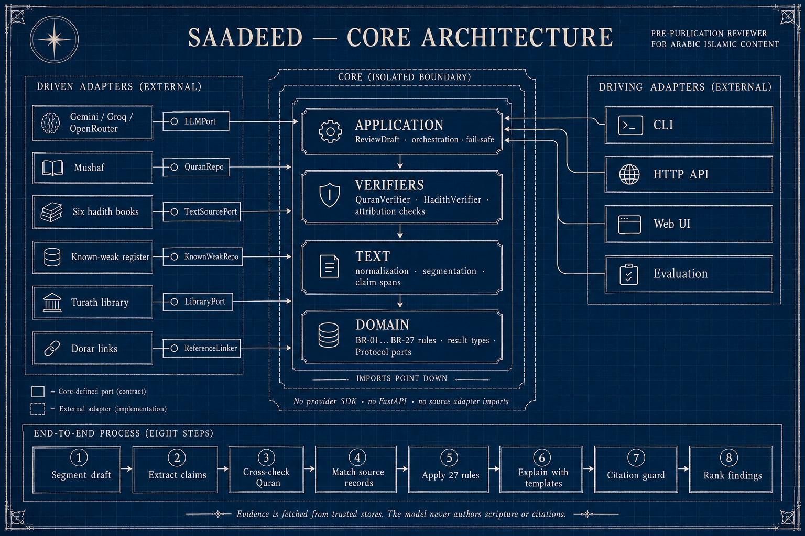

<p align="right">
  
</p>

# سَدِيد
## مُراجِعُ ما قبلَ النَّشرِ للمحتوى الدعوي

> [﴿يَا أَيُّهَا الَّذِينَ آمَنُوا اتَّقُوا اللَّهَ وَقُولُوا قَوْلًا سَدِيدًا﴾](https://youtu.be/4AoV5EYGGNw)  
> **[الأحزاب: ٧٠]**

**[جرّب سديد](https://abdorum-saadeed.static.hf.space)** · [البدء السريع](#البدء-السريع) · [الواجهة البرمجية](#الواجهة-البرمجية) · [البنية](#البنية) · [English](README.en.md)

<p align="right">
  
  
  
  
</p>

---

## قبل أن يبلغ القولُ الناس

لم تبدأ مشكلة المحتوى الدعوي مع الذكاء الاصطناعي، وإنما زادت سرعته واتسعت قدرته على الانتشار. فقد تكون المسودة حسنة العبارة، حسنة القصد، ثم يدخل عليها من مواضع الخلل ما لا يظهر لمن كتبها: آية تغيّر لفظها، أو حديث نُقل بغير ما يحتمل، أو قول نُسب إلى صاحبه، أو رقم وتعميم لم يُوثّقا، أو قصة من التراث اشتهرت على الألسن ولم تثبت. وكثيرًا ما نرى شبابًا حسني القصد، ذوي همة في الدعوة، ينقلون ما ظنوه خيرًا، ثم لا يلبث أن ينتشر القول حتى يصعب ردّه إلى موضعه الأول أو تصحيح أثره. ومع ازدياد سرعة إنتاج الكلام وتداوله، ازدادت الحاجة إلى **وقفة تأمل وتثبّت قبل أن يبلغ القول الناس**.

ومن هنا اختير لسديد أن يعمل على **قناة قائمة، لا أن يخترع قناة جديدة**: الخطبة، والدرس، والموعظة، والمقال، وما يتفرع عنها مما يتداول قنوات ظلّت تحمل الرسالة منذ أن أرسل الله الرسل. وما زالت تبلغ ملايين المسلمين كل أسبوع في خطب الجمعة مهما كان البلد والخلفية. فلم تكن الغاية أن نضيف إلى العالم الإسلامي واعظًا آليًا جديدًا، ولا أن نستبدل الداعية، بل أن نضع بين **المسودة والمنبر، وبين الكلمة ووصولها إلى الناس، طبقةً أخرى من التثبت**. جاء سديد ليكون عونًا للواعظ على أن يرى ما قد يفوته في زحمة الإعداد، فيكشف له مواضع الخلل، ويضع الدليل حيث أمكن، ويحذّره حيث ينبغي الحذر؛ حتى لا تتحول قصة حُكيت على غفلة إلى فهم يُبنى عليه، أو نسبة لا أصل لها إلى قول يُنسب إلى الدين.

وفي الأفق البعيد: كثير من الخصومة والتعصب يبدأ من نقل لم يُتثبت منه: قصة لا تصح يُبنى عليها موقف من عالم، أو قول يُنسب إلى عالم فيُحاكَم عليه أتباعه. ونرجو أن يُسهم سديد، مع غيره، في أن يقلل هذا التفرق والانقسامات، حين يصير التثبت قبل النشر عادة، وهذا رجاءٌ نعلنه سيتحقق في عصر الذكاء الخارق بإذن الله.

---

## ما هو سديد؟

**سديد مراجِع قبل النشر للمحتوى الدعوي.**

يستقبل مسودة الخطبة أو الدرس أو المقال، ويستخرج ما فيها من آيات وأحاديث وأقوال منسوبة وإجماع مدّعى وأرقام وتعميمات، ثم يضع بجانب كل موضع ثلاثة أشياء:

- **الدليل:** نص المصدر المعتمد، بموضعه ورابطه.
- **حالة الدليل:** ما الذي يثبته المصدر، وما الذي لم يُتحقق منه.
- **الخطوة التالية:** لا شيء، أو وثّق، أو صحّح من المصدر، أو أعِد الصياغة، أو أحِل إلى مختص.

مدققات الاقتباس تفحص ما بين القوسين، **وسديد يفحص الخطبة كلها**، ثم يرتّب ما وجده بثمن الخطأ: **الأخطر أولًا.**

> **سديد لا يكتب عنك؛ سديد يريك ما قد لا تراه.**
> **الدليلُ قبل الحكم، والحكمُ لأهله.**

---

## ماذا يرى الكاتب؟

المسودة كما كتبها في الوسط، لا يُمس منها حرف، وملاحظات سديد **حواشٍ** مرقمة بجانب كل موضع، كما يعلّق الشيخ على متن تلميذه.

| في المسودة | ما يقوله سديد |
|---|---|
| آية تبدّلت فيها كلمة | **يخالف المصدر**، والفرق كلمة بكلمة بجانب نص المصحف |
| آية نُسبت إلى النبي ﷺ | «هذا النص آية من القرآن الكريم (البقرة: 153)، والمسودة تنسبه إلى النبي ﷺ» |
| حديث في الصحيحين | **مطابق للمصدر**، والنص من المخزن |
| حديث في السنن الأربع | **وُجد دون حكم**، ومعه حكم المحدّث منقولًا بنسبته إن وُجد، ورابط الدرر |
| حديث مشتهر لا يصح | الحكم منقول بنسبته، **ومعه ما ثبت في معناه** |
| حديث لم يُعثر عليه | **لم يُعثر عليه في مصادر سديد**، وهذا لا يعني أنه لا يصح |
| قول منسوب إلى عالم، أو قصة من التراث | يُبحث عنه في كتب العلماء: «وجدناه بنصه في…» بالكتاب والجزء والصفحة، أو «لم نجده» |
| «أجمع العلماء…»، ورقم، وتعميم مضلل | **يحسن توثيقه**، ومعه اقتراح صياغة موسوم «مولَّد» |
| فتوى لحالة شخصية | **أحِل إلى مختص**: سديد لا يفتي |

**جرّبه:** https://abdorum-saadeed.static.hf.space. الصق مسودتك (حتى 3000 كلمة)، أو اختر أحد الأمثلة. بلا تسجيل، وللتحليل الكامل ضع مفتاح نموذجك في «الإعدادات»، فيُرسل مع طلبك وحده ولا يُحفظ. **ولا تُخزَّن المسودات ولا تُسجَّل.**

---

## كيف يعمل؟


| الطرف | دوره |
|---|---|
| **الذكاء الاصطناعي** | يجد ويقارن: يستخرج الادعاءات، ويختار الحديث المطابق من مرشحين جلبهم البحث من المخزن |
| **المخزن** | يشهد: كل نص شرعي معروض يُجلب منه بمعرّفه، ولا يكتبه النموذج |
| **القواعد** | تزن: جدول مكتوب من 27 قاعدة يقرر حالة الدليل وأثر الخطأ والإجراء |
| **الإنسان** | يحكم |

- **الآيات حرفًا بحرف** بلا نموذج لغوي، مع التسامح مع رسم المصحف.
- **الفحص المتقاطع:** كل ادعاء يُعرض على المصحف أيًّا كان تصنيفه، فلا تفلت آية ظنها النموذج حديثًا.
- **حارس الإسناد:** المصدر الذي لا وجود له في المخزن يُسقط قبل العرض.
- **الفشل الآمن:** إن تعذّر النموذج بقيت الآيات والأحاديث المعلَّمة تُفحص، وقال التقرير صراحة ما لم يُفحص.

التفصيل في [الأسئلة الشائعة](docs/02-FAQ.md) و[المصادر والوظائف](docs/03-TECHNICAL.md).

---

## هل يعمل فعلًا؟

قسنا سديد مقابل **النموذج نفسه وحده** (`gemini-3.5-flash-lite` بتعليمات جيدة)، أي ما يفعله الكاتب اليوم حين يسأل نموذجًا عامًا عن مسودته:

| | سديد | النموذج وحده |
|---|---|---|
| الكشف: المعيب نُبّه عليه | **96.7%** | 83.3% |
| الإنذار الكاذب على السليم | **3.2%** | 16.1% |
| الحالات الحرجة الفائتة | **0 من 24** | 2 |
| مصادر مختلقة | **0** | 5 |

- **الفرق دال إحصائيًا** (McNemar الدقيق، p = 0.0075)، على 91 حالة، ببروتوكول سُجّل قبل القياس.
- **وبنموذج آخر** (`gpt-oss-120b`) جاء سديد بالأرقام نفسها. فالضمانات دقيقة من المعمارية، لا من النموذج.
- **وعلى عشر خطب منشورة حقيقية** (13,303 كلمة): صفر إنذار حرج كاذب. والتنبيه الحرج الوحيد كان خطأً حقيقيًا في آية بخطبة منشورة: «وَلولوْ ردوه» [النساء: 83].
- **وما لم نثبته بعد:** مجموعة الاختبار المحجوزة جُمّدت ببصمتها ولم تُشغَّل، وتُعلن أرقامها بعد اعتماد حالاتها.

**أعد القياس بنفسك دون مفتاح:** `uv run saadeed eval run --split dev --systems saadeed,B0 --replay`. والتفصيل في [التحقق العلمي](docs/04-EVALUATION.md).

---

## المصادر

لكل مصدر دور يحدد أقصى ما يجوز لسديد أن يقوله بناءً عليه:

| المصدر | دوره | ما يقوله سديد بناءً عليه |
|---|---|---|
| **المصحف:** [الموسوعة القرآنية](https://quranpedia.net)، وTanzil وصلة بديلة | نص معتمد | مطابق، أو يخالف المصدر |
| **صحيح البخاري ومسلم:** [Open-Hadith-Data](https://github.com/mhashim6/Open-Hadith-Data) | احتجاج | مطابق للمصدر |
| **السنن الأربع** | موضع | وُجد دون حكم |
| **قائمة «المشتهر الذي لا يصح»** | حكم منقول | الحكم بنسبته واسم مراجعه |
| **كتب العلماء:** [مكتبة تراث](https://app.turath.io) | موضع | أين ورد القول، دون حكم |
| **الدرر السنية** | إحالة | رابط يفتحه الإنسان |

كل مصدر «وصلة» تُبدَّل أو تُضاف بتعديل [`data/manifest.toml`](data/manifest.toml) وحده، وكل تقرير يحمل بصمة هذا الملف. والتراخيص في [`data/SOURCES.md`](data/SOURCES.md).

---

## ما لا يفعله سديد

- **لا يفتي، ولا يرجّح بين الأقوال.**
- **لا يولّد نص آية أو حديث.**
- **لا يحوّل «لم أعثر» إلى «لا يصح»**، ولا «وُجد» إلى «صحّ». فحدوده حدود مصادره.

---

## للمطورين

### البنية



- **النواة أربع طبقات:** `domain` ← `text` ← `verifiers` ← `application`. كل طبقة لا تستورد إلا ما تحتها، والنواة كلها لا تستورد محوّلًا ولا مكتبة مزود ولا FastAPI. والعقدان مكتوبان في `pyproject.toml`، و`lint-imports` يُفشل البناء إن خولفا.
- **المنافذ** عقود `Protocol` في `src/saadeed/domain/ports.py`: `LLMPort`، و`QuranRepo`، و`TextSourcePort`، و`KnownWeakRepo`، و`LibraryPort`، و`ReferenceLinker`.
- **المحوّلات** في `src/saadeed/adapters/`: `api` و`cli` و`eval` تستدعي النواة، و`llm` و`sources` تستدعيها النواة عبر المنافذ. و`factory.py` يركّبها.
- **ولهذا** فتبديل النموذج متغير في `.env`، وتبديل مصدر سطر في `data/manifest.toml`، ولا تُمس النواة في الحالين.

### البدء السريع

**المتطلبات:** Python 3.12، و[uv](https://docs.astral.sh/uv/).

```bash
git clone https://github.com/abdorum/Saadeed && cd Saadeed
uv sync                       # البيئة والمكتبات
uv run saadeed data build     # تنزيل المصادر وبناء الفهارس (مرة واحدة، نحو 230 م.ب.)
cp .env.example .env          # ضع مفتاحك، أو اتركه فارغًا للمسار الحتمي وحده
uv run saadeed serve          # الصفحة والواجهة البرمجية: http://127.0.0.1:8000
```

**ويكفي مفتاح واحد،** وبلا مفتاح يعمل المسار الحتمي: الآيات، والأحاديث المعلَّمة، وقائمة المشتهر.

### سطر الأوامر

```bash
uv run saadeed review samples/alukah_hifz_allisan.txt            # خطبة منشورة حقيقية
uv run saadeed review samples/demo_khutbah.txt --provider none   # بلا نموذج: المسار الحتمي وحده
uv run saadeed review draft.txt --json -o report.json            # التقرير JSON كاملًا في ملف
cat draft.txt | uv run saadeed review -                          # من المدخل القياسي
uv run saadeed coverage                                          # المصادر المفعّلة وأدوارها
```

| الخيار | وظيفته |
|---|---|
| `--provider` | `gemini` أو `groq` أو `openrouter`، أو `none` للمسار الحتمي وحده |
| `--model` | اسم النموذج لدى المزود |
| `--json`، `-o FILE` | التقرير JSON بدل الملخص، أو حفظه في ملف |
| `--cache` | `use` أو `replay` أو `off`: ذاكرة نداءات النموذج، للتسجيل والإعادة |
| `--overreach` | فحص التجاوز (تجريبي) |

### الواجهة البرمجية

`uv run saadeed serve` يشغّلها، وتوثيقها التفاعلي على `/v1/docs`، ومخططها في [`docs/openapi.json`](docs/openapi.json) لتوليد عميل بأي لغة.

| الطلب | وظيفته |
|---|---|
| `POST /v1/reviews` | راجِع مسودة، ويعيد التقرير |
| `GET /v1/health` | الإصدار، والنموذج، وبصمة ملف المرجعية |
| `GET /v1/coverage` | المصادر المفعّلة وأدوارها، والسياسات |
| `GET /v1/results` | أحدث تقرير تقييم: سديد مقابل النموذج وحده |
| `POST /v1/llm/check` | يختبر مفتاح نموذج دون أن يحفظه |

```bash
curl -s http://127.0.0.1:8000/v1/reviews \
  -H "Content-Type: application/json" \
  -d '{"text": "قال رسول الله ﷺ: «إن الله مع الصابرين».", "mode": "quick"}'
```

| الحقل | القيم | معناه |
|---|---|---|
| `text` | حتى 3000 كلمة | المسودة |
| `mode` | `full` (الافتراضي) أو `quick` | `quick` المسار الحتمي وحده: فوري، وبلا نموذج |
| `llm` | `{"provider", "model", "api_key"}` | نموذج ومفتاح لهذا الطلب وحده، لا يُحفظ ولا يُسجَّل. و`"provider": "none"` للمسار الحتمي |
| `overreach` | `false` أو `true` | فحص التجاوز (تجريبي) |

<details>
<summary><b>الرد (مختصرًا)</b></summary>

```json
{
  "schema_version": "1.1",
  "mode": "quick",
  "summary": { "total_claims": 1, "by_bucket": { "SUPPORTED_BY_SOURCES": 0, "NEEDS_VERIFICATION": 1, "REFER": 0, "NOT_CHECKED": 0 } },
  "findings": [
    {
      "rule_id": "BR-22",
      "claim": { "text": "إن الله مع الصابرين", "type": "QURAN_QUOTE", "span": { "start": 18, "end": 37 } },
      "evidence_status": "PARTIALLY_SUPPORTED",
      "severity": "HIGH",
      "action": "CORRECT_FROM_SOURCE",
      "bucket": "NEEDS_VERIFICATION",
      "explanation": "هذا النص آية من القرآن الكريم (البقرة: 153)، والمسودة تنسبه إلى النبي ﷺ.",
      "next_step": "انسبه إلى القرآن («قال تعالى») واذكر موضعه: البقرة: 153.",
      "evidence": [
        {
          "ref": { "source_id": "quran", "item_id": "2:153", "citation": "البقرة: 153", "url": "https://quranpedia.net/ayahs/2/153" },
          "role": "REFERENCE_TEXT",
          "text": "يَٰٓأَيُّهَا ٱلَّذِينَ ءَامَنُواْ ٱسۡتَعِينُواْ بِٱلصَّبۡرِ وَٱلصَّلَوٰةِۚ إِنَّ ٱللَّهَ مَعَ ٱلصَّٰبِرِينَ (153)"
        }
      ],
      "labels_ar": { "evidence_status": "مطابق جزئيًا", "severity": "مرتفع", "action": "صحّح من المصدر", "bucket": "يتطلب تحققًا", "claim_type": "آية قرآنية" }
    }
  ],
  "meta": { "saadeed_version": "0.6.0", "llm": "none", "policy_version": "BR-2026.10.06-v2.6",
            "manifest": { "id": "saadeed-2026.10-v4", "sha256": "ce27c52a9966…" }, "llm_calls": 0, "degraded": false }
}
```

وفي الرد الكامل أيضًا: `top_risks` (أخطر المواضع)، و`draft_map` (تصنيف كل جملة)، و`coverage`، وعدد النداءات والتوكنز في `meta`.
</details>

**الأبعاد الثلاثة لكل ملاحظة** رموز ثابتة، ومعها تسميتها العربية في `labels_ar`:

| البعد | القيم |
|---|---|
| `evidence_status` حالة الدليل | `SUPPORTED` مطابق للمصدر · `PARTIALLY_SUPPORTED` مطابق جزئيًا · `EXCEEDS_SOURCE` يتجاوز المصدر · `CONTRADICTED` يخالف المصدر · `FOUND_NO_RULING` وُجد دون حكم · `NOT_FOUND` لم يُعثر عليه · `OUT_OF_SCOPE` خارج نطاق الفحص · `NOT_CHECKED` لم يُفحص |
| `severity` أثر الخطأ | `CRITICAL` حرج · `HIGH` مرتفع · `MEDIUM` متوسط · `LOW` منخفض · `NONE` |
| `action` الإجراء | `NONE` لا إجراء · `VERIFY` تحقّق ووثّق · `CORRECT_FROM_SOURCE` صحّح من المصدر · `RECONSIDER` أعِد النظر في الاستشهاد · `REPHRASE` أعِد الصياغة وطوّرها · `REFER` أحِل إلى مختص |
| `bucket` المسار | `SUPPORTED_BY_SOURCES` تؤيده المصادر · `NEEDS_VERIFICATION` يتطلب تحققًا · `REFER` إحالة إلى مختص · `NOT_CHECKED` لم يُفحص |

- **الأخطاء:** `422` لمسودة فارغة أو أطول من الحد، و`429` إن تجاوز العنوان حد المراجعات الكاملة في الدقيقة، و`400` لمزود أو مفتاح غير صالح في `llm`. والسبب بالعربية في `detail`.
- **المراجعة الناقصة لا تُخفى:** إن تعذّر النموذج بقي المسار الحتمي، وصار `meta.degraded` صحيحًا، وذُكر ما لم يُفحص في `summary.not_checked`.
- **من المتصفح:** النطاقات المسموح لها في `SAADEED_CORS_ORIGIN_REGEX`.

```python
import httpx

r = httpx.post("http://127.0.0.1:8000/v1/reviews", json={"text": draft}, timeout=180)
r.raise_for_status()
for f in r.json()["findings"]:
    print(f["labels_ar"]["severity"], f["claim"]["text"], "←", f["explanation"])
```

### مكتبة Python

النواة تعمل دون خادم أيضًا:

```python
from saadeed.adapters.factory import build_engine, build_llm

engine = build_engine()                         # يبني الفهارس مرة واحدة، ثم يُعاد استعماله
reviewer = engine.reviewer(build_llm("none"))   # build_llm() للنموذج المضبوط في .env
report = reviewer.review("قال رسول الله ﷺ: «إن الله مع الصابرين».")

for f in report.findings:
    print(f.rule_id, f.labels_ar["evidence_status"], f.explanation)
# BR-22 مطابق جزئيًا هذا النص آية من القرآن الكريم (البقرة: 153)، والمسودة تنسبه إلى النبي ﷺ.
```

`report` كائن pydantic بمخطط الرد نفسه، و`report.model_dump(mode="json")` يعطيه JSON.

### الإعداد

كل الإعداد متغيرات بيئة في `.env`، ولا يُرفع إلى المستودع.

| المتغير | الافتراضي | وظيفته |
|---|---|---|
| `GEMINI_API_KEY` | — | النموذج الافتراضي `gemini-3.5-flash-lite` ([Google AI Studio](https://aistudio.google.com/apikey)) |
| `OPENROUTER_API_KEY` | — | احتياطي يجيب إن تعذّر Gemini ([OpenRouter](https://openrouter.ai/keys)) |
| `GROQ_API_KEY` | — | بديل كامل مع `SAADEED_LLM_PROVIDER=groq` ([Groq](https://console.groq.com/keys)) |
| `SAADEED_LLM_PROVIDER` / `SAADEED_LLM_MODEL` | `gemini` / بحسب المزود | تبديل المزود أو النموذج دون مس الكود |
| `SAADEED_LIBRARY` | `turath` | البحث الحي في كتب العلماء، و`off` يعطله |
| `SAADEED_RATE_LIMIT` | `12` | المراجعات الكاملة لكل عنوان في الدقيقة |
| `SAADEED_CORS_ORIGIN_REGEX` | نطاقات Hugging Face | من يُسمح له باستدعاء الواجهة البرمجية من المتصفح |
| `SAADEED_WEB` / `SAADEED_WEB_URL` | `on` / صفحة HF | `off` يجعل الخادم للواجهة البرمجية وحدها، و`/` يحيل إلى `SAADEED_WEB_URL` |
| `SAADEED_CACHE_DIR` | `.cache/llm` | ذاكرة نداءات النموذج في سطر الأوامر والتقييم |
| `SAADEED_DATA_DIR`، `SAADEED_MANIFEST`، `SAADEED_PROMPTS_DIR` | مجلدات المستودع | تشغيل سديد ببيانات أو ملف مرجعية أو تعليمات أخرى |

### النشر

- **خادم:** `deploy/saadeed.service` خدمة systemd تشغّل `saadeed serve` خلف وكيل عكسي، وتعيده إن توقف، بحدود للذاكرة والمعالج. والمسار الفرعي بـ `--root-path`.
- **الصفحة وحدها:** `bash deploy/deploy_hf_static.sh` ينشر `web/` على Hugging Face Space ثابتة، تستدعي الخادم على `SAADEED_API_URL`.
- **Docker:** صورة واحدة فيها الصفحة والواجهة البرمجية، وتُبنى البيانات داخلها:
  ```bash
  docker build -t saadeed . && docker run -p 7860:7860 --env-file .env saadeed   # http://127.0.0.1:7860
  ```

### التوسيع

- **كتاب حديث آخر** من مجموعة Open-Hadith-Data: سطر في `data/manifest.toml` بدوره (`AUTHENTIC` أو `LOCATE`)، بلا كود.
- **نوع مصدر جديد:** محوّل في `src/saadeed/adapters/sources/` يحقق المنفذ المناسب، ثم فرع في `adapters/bootstrap.py`، ثم سطر في ملف المرجعية. والدور وحده (`REFERENCE_TEXT` · `AUTHENTIC` · `RULING` · `LOCATE` · `LINK`) يحدد أقصى ما يجوز للمصدر أن يقرره.
- **مزود نموذج جديد:** صنف فيه `model_id` و`generate_json(system, user, max_tokens)` (عقد `LLMPort`)، ثم فرع في `build_llm` في `adapters/factory.py`.
- **قاعدة أو نوع ادعاء جديد:** في `domain/enums.py` و`domain/policy.py` و`domain/templates.py`. و`tests/unit/test_extensibility.py` يفشل إن نُسيت خطوة. **وكل حكم شرعي في الجدول يراجعه مختص.**

### الاختبارات وإعادة القياس

```bash
uv run pytest -q && uv run ruff check src tests && uv run lint-imports   # 144 اختبارًا، والأسلوب، وحدود المعمارية
uv run saadeed eval run --split dev --systems saadeed,B0 --replay          # أرقام التقييم دون مفتاح، من التسجيلات
```

ومجموعة الاختبار المحجوزة (test) مجمّدة ببصمتها في [البروتوكول](docs/planning/05-evaluation-protocol.md) §١١، ولم تُشغَّل بعد.

### هيكل المستودع

```text
src/saadeed/
  domain/        النماذج، وجدول القواعد، والقوالب، والمنافذ
  text/          التطبيع، والتقطيع، والعلامات، والمحاذاة
  verifiers/     متحقق الآيات (حتمي) ومتحقق الأحاديث
  application/   حالة الاستخدام ReviewDraft، وحارس الإسناد، والفحص المتقاطع
  adapters/      api · cli · eval · llm · sources، و factory.py يركّبها
web/             الصفحة: HTML وCSS وJS بلا خطوة بناء، والأمثلة بتقاريرها المحفوظة
prompts/         تعليمات النموذج بإصداراتها، وفهرسها prompts.json
data/            ملف المرجعية، وقائمة المشتهر، والمصادر المثبّتة
eval/            بنك الحالات، والتقارير، والتسجيلات، وسجل الأخطاء ERRORS.md
tests/           اختبارات الوحدة والعقود
deploy/          خدمة systemd، ونشر الصفحة
docs/            الوثائق، والصور ومصادرها في docs/assets، ومخطط OpenAPI
```

---

## الوثائق

| الوثيقة | ما فيها |
|---|---|
| [الرؤية](docs/01-VISION.md) | لماذا سديد، ولمن، والمبدأ الحاكم، وحدوده |
| [الأسئلة الشائعة](docs/02-FAQ.md) | ما النواة، ومسار المسودة من الإدخال إلى التقرير، والفرق عن RAG |
| [المصادر والوظائف](docs/03-TECHNICAL.md) | كل وظيفة، ومصدرها، وطريقة أدائها، وقاعدتها |
| [التحقق العلمي](docs/04-EVALUATION.md) | كيف قسنا، وكيف تعيد القياس |
| [تجربة المستفيد](docs/05-UX.md) | كيف يُستعمل سديد وكيف ينبغي أن يُستعمل، ومثال كامل |
| [المتطلبات وجدول القواعد](docs/planning/03-requirements.md) · [المعمارية](docs/planning/04-architecture.md) · [بروتوكول التقييم](docs/planning/05-evaluation-protocol.md) | الوثائق التأسيسية كما كُتبت قبل الكود |
| [مخطط الواجهة البرمجية](docs/openapi.json) | OpenAPI 3، لتوليد عميل بأي لغة |
| [سجل الإصدارات](CHANGELOG.md) · [سجل الأخطاء](eval/ERRORS.md) | ما تغيّر في كل إصدار، وكل فشل وكيف أُصلح |

---

## عن المشروع

- **المؤلف:** عبدو.
- **الإصدار:** 0.6.0 ([سجل الإصدارات](CHANGELOG.md)).
- **الترخيص:** الكود MIT ([LICENSE](LICENSE))، والبيانات بتراخيص مصادرها ([`data/SOURCES.md`](data/SOURCES.md)). ومن استعمله فليذكر مصدره ([CITATION.cff](CITATION.cff)).
- **الخطوط:** Amiri للعناوين، وIBM Plex Sans Arabic للنص، وAmiri Quran لنص المصحف، وكلها بترخيص SIL OFL.

> ﴿وَلَا تَقْفُ مَا لَيْسَ لَكَ بِهِ عِلْمٌ﴾ [الإسراء: ٣٦]
